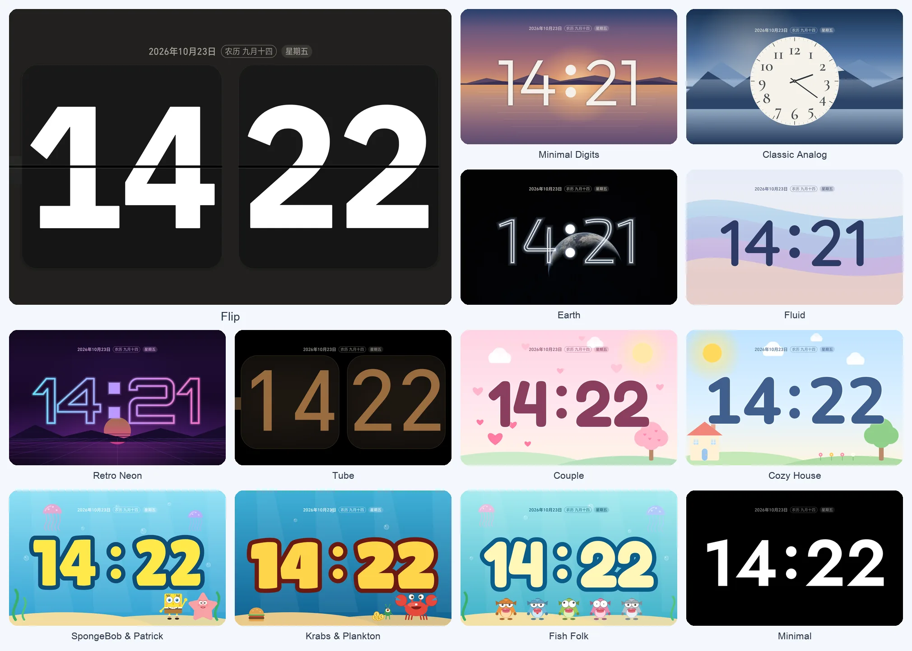
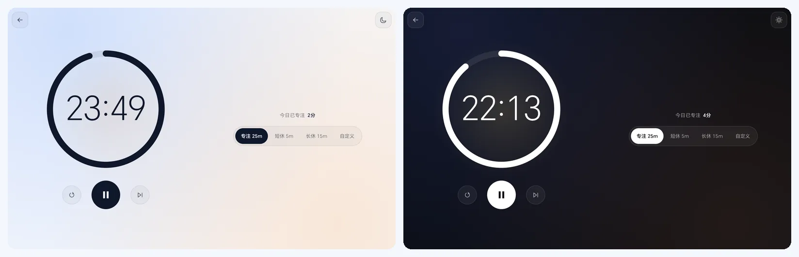
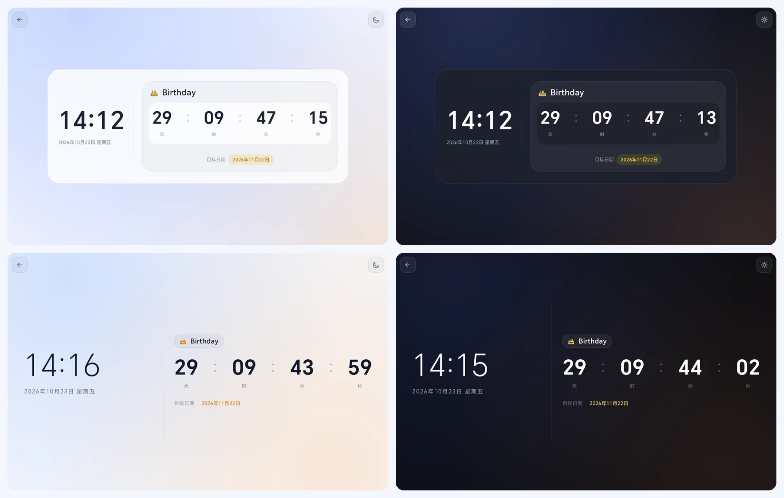

# ScreenClock

**English** | [简体中文](README.zh-CN.md)


Put an Android phone or tablet on your desk or bedside, open ScreenClock, and it becomes a full-screen clock. The face leaves the room to the time; date, weather and the days that matter show up only when you want them. Portrait and landscape are both supported. Requires **Android 8.0 (API 26)** or newer.


> **Note on language:** the app's own interface is currently **Simplified Chinese only**, and the screenshots below show it as is. Dates on the clock face follow the Chinese format (for example, a lunar-calendar tag next to the weekday).

## Install and get started

Download the latest `ScreenClock-v*.apk` from [GitHub Releases](https://github.com/AlexWuYh/ScreenClock/releases/latest). It is signed with the project's release key. Open it on a device running Android 8.0 or newer; if the system asks you to allow installs from the current source, confirm that yourself. Each release also ships a `.sha256` checksum file.

**Already have a self-built or earlier Debug APK?** Debug and release builds are signed with different keys, so Android cannot install one over the other, and uninstalling the old one clears your settings and anniversaries. Back that data up first, then decide whether to switch. Later releases use the same release key and can be installed over each other. Contributors can still build a Debug APK by following [Build from source](#build-from-source-contributors).

After opening the app, **tap an empty spot on the clock**. Four buttons appear at the bottom: Theme, Settings, Focus and Anniversaries. On first launch they stay on screen a little longer with a hint; afterwards they hide after about 8 seconds of inactivity (longer when a screen reader or other accessibility service asks for more time). On the clock, one press of Back hides the buttons and a second press leaves the app. Tap Theme to cycle through the clocks quickly, or open Settings to pick colors and adjust the layout.

## Pick a clock face

**Settings → Display** lists many themes with live previews, and the Theme button at the bottom cycles through them in order.



| Theme | Look |
| --- | --- |
| Flip | Mechanical flaps that fold; three finishes: **ink black, snow white, graphite** |
| Minimal Digits | Gradient dusk sky over a lake |
| Classic Analog | Hand-style dial with serif numerals over snowy ridges |
| Earth | A NASA photograph of Earth with glowing digits |
| Fluid | Soft wave bands and gradients |
| Retro Neon | Neon squared digits, a sunset and a grid |
| Tube | Dark amber digits that glow briefly on every minute change |
| Couple | A cherry-blossom pink sky, hearts and a blossom tree |
| Cozy House | A little house on a sunny meadow, no people |
| SpongeBob & Patrick | Bright blue seabed, thick-outline cartoon digits |
| Krabs & Plankton | Deep sea, a Krabby Patty and coins |
| Fish Folk | A row of deadpan background fish |
| Minimal | Pure black with bold white digits |

Every theme except Flip has its own digit typeface. The date line splits the date, lunar date, weekday and holiday into differently styled tags so each kind reads at a glance. The characters in the SpongeBob themes are fan-style illustrations drawn by this project; rights to those characters belong to their owners.

The clock follows the system 12/24-hour setting or can be fixed to either. Date, year, lunar date, weekday and holiday can each be switched on or off; the date can sit above or below the digits, and digits come in compact, standard and large sizes. Holiday names appear only on days where they apply, and long lines may be shortened on narrow screens. **The normal clock never shows seconds.** Not every theme animates: Flip folds, and Tube glows when the minute changes.

## Focus, anniversaries and weather

- **Focus (Pomodoro timer)**: open it from **Focus** at the bottom. A ring and a large countdown sit above reset, play/pause and skip. On the right you choose **Focus 25 min / Short break 5 min / Long break 15 min / Custom 1–180 min**. When time is up it stops at "time's up" and you pick the next segment yourself; it never loops on its own. The screen stays on while counting and may sleep while paused. Leaving for the clock does not end the timer, and after a restart the app carries on from the end time. **Focused today** shows at the top and adds up only real time spent in Focus mode (breaks and Custom do not count); it stays on the device.



- **Anniversaries**: up to 30, as a one-off solar date, a yearly solar date or a yearly lunar date (including leap months). Each can have an icon (cake, heart, gift, trip, graduation, ring, star, flag). When adding or editing, quick dates (**in 7 days / 30 days / 100 days / same day next year**) fill in the date for you, and the next matching calendar date is shown. Pin one to show it below the clock. Tapping the pinned item, or opening one from the list, shows a full-screen countdown that always reads **days : hours : minutes : seconds**, and a custom message once the day begins. Deleting asks for confirmation. The countdown page does not hold the screen on, and the app does not reopen it after a restart.
- **Look of the countdown and focus pages**: the countdown has a **Card** and an **Immersive** style, chosen in **Settings → Anniversaries**. Light/dark can be System, Light or Dark, and the focus page shares this one setting. Back is at the top left and a light/dark switch at the top right; both fade out after about 10 seconds and come back with a tap on the screen.



- **Weather (optional, off by default)**: search for a city, or turn on "Use current location". The weather and a Celsius temperature appear below the clock, and wider screens also show today's high and low. Data comes from [Open-Meteo](https://open-meteo.com/); with a city chosen and the app in the foreground, an expired cache is refreshed about every 30 minutes. With no network, no city or no location, the weather may be hidden or show older data for a while. Searching for and choosing a city triggers requests.

## Bedside use and burn-in protection

Everything in **Settings → Night** is **off by default**:

- **Night dimming**: lowers the brightness of *this app's window* during a local time range, without touching system brightness. The default is 22:00–07:00; it can cross midnight, and equal start and end times mean it never dims.
- **Night warm tint**: adds a warm tint, only while night dimming is in effect.
- **Keep screen on while charging**: keeps the screen on while the device is plugged in; it does nothing on battery. Without it, the normal clock does not stay on just because it is a clock.

**Settings → Burn-in protection** is also off by default. Once on, you set how long to wait without a touch and how long one pass lasts: the clock drifts slightly, and after the idle time it moves for one pass and then stops, **it does not loop forever**. Touching the screen ends the pass and restarts the wait. It cannot guarantee that no screen will suffer burn-in, so lowering brightness and letting the device rest still help. The focus and countdown pages never start a pass.

## Privacy, permissions and limits

| Permission | Purpose |
| --- | --- |
| Network (`INTERNET`) | Used only by weather: searching for a city and asking Open-Meteo for the chosen place. With weather off, no weather request is made. |
| Approximate location (`ACCESS_COARSE_LOCATION`) | Asked for only when you turn on "Use current location" in weather. If you decline, you can still search for a city by hand. |

A weather request sends the search term or the chosen place's coordinates to Open-Meteo. With current location, the app labels it "current location" and does no reverse geocoding. Settings, the weather cache and anniversaries are stored in the app's local data, and there is no account or sync service of its own. The Android manifest does allow system backup, though, and whether anything is backed up depends on the device's settings, so "stored locally" should not be read as "never backed up by the system". The clock, focus timer and anniversaries all work without location.

There are currently no alarms, spoken or notification chimes, flip sounds, home-screen widgets, world clocks or multi-city weather, and no focus history or reports (only today's focused time). It is also not a system-level burn-in tool, and night dimming affects only this app's window.

## Build from source (contributors)

The project is a single-module Android app. You need **JDK 17**, Android SDK Platform **`android-37.0`** and Build-Tools **`36.0.0`**. Create an untracked `local.properties` in the repository root with your SDK path:

```properties
sdk.dir=/path/to/Android/sdk
```

Then, from the repository root:

```bash
./gradlew :app:assembleDebug
```

The debug package is written to `app/build/outputs/apk/debug/app-debug.apk`; it is **not** signed with the key used for GitHub Releases. To check your changes you can also run `./gradlew :app:testDebugUnitTest` and `./gradlew :app:lintDebug`. Instrumented tests need a connected device, and merely compiling the test APK does not mean they passed on a device.

After a maintainer updates `versionName` and `versionCode` in `app/build.gradle.kts`, pushing a matching `vX.Y.Z` tag on that commit runs the unit tests, lint and signed packaging automatically, then publishes the APK and its SHA-256 file. The release signing key lives in GitHub Actions Secrets; neither the key nor its passwords are in the repository. Keep the key safely backed up offline, or later releases can no longer be installed over this one.

## License

This project is released under the [MIT License](LICENSE).

### Third-party content

| Item | Used for | License |
| --- | --- | --- |
| [`cn.6tail:lunar`](https://github.com/6tail/lunar-java) | Lunar-calendar conversion | MIT |
| [Open-Meteo](https://open-meteo.com/) | Weather data | CC BY 4.0 |
| IBM Plex Mono Bold | Flip theme digits | [SIL OFL 1.1](app/src/main/assets/fonts/IBMPlexMono-OFL.txt) |
| Outfit, Jost, Cormorant Garamond, Exo 2, Quicksand, Orbitron, Fredoka, Nunito, Lilita One, Titan One | Digits of the other themes | SIL OFL 1.1 |
| NASA photograph of Earth | Earth theme background | Provided by NASA |

The font files ship with the app, in `app/src/main/assets/fonts`.
