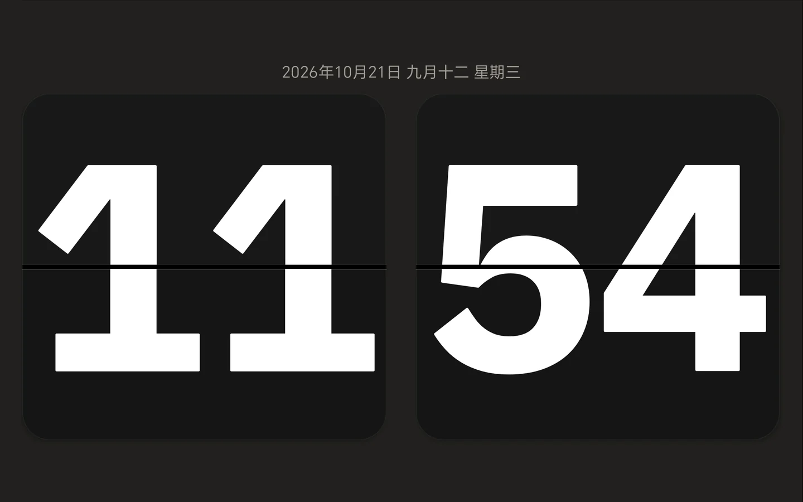

# ScreenClock


把 Android 手机或平板放在桌上、床头，打开 ScreenClock，就是一块全屏时钟。钟面尽量留给时间；需要时再显示日期、天气和重要日子。支持竖屏与横屏，最低需要 **Android 8.0（API 26）**。



## 安装与上手

可从 [GitHub Releases](https://github.com/AlexWuYh/ScreenClock/releases/latest) 下载最新的 `ScreenClock-v*.apk`。该 APK 使用项目专用发布密钥签名；下载后在 Android 8.0 或更新的设备上打开安装，若系统要求允许当前来源安装，请自行确认。随 Release 提供同名 `.sha256` 校验文件。

**已有自行编译或先前提供的 Debug APK？** 调试版与正式版的签名不同，Android 无法直接覆盖安装；卸载旧版会清除应用内设置和纪念日。请先妥善备份这些数据，再决定是否切换到正式版。此后的正式版将使用同一把发布密钥，可覆盖升级。贡献者仍可按下方的[自行构建](#自行构建)步骤生成 Debug APK。

打开应用后，**点一下钟面空白处**，底部会出现「主题」「设置」「专注」「纪念日」；首次启动会多停留几秒并给出提示，之后闲置约 8 秒会自动收起；开启读屏等无障碍服务时会按系统建议的时长更久。钟面上按一次返回键先收起按钮，再按一次才退出。点「主题」可快速循环切换，想挑选配色或调整布局则进入「设置」。

## 挑一块喜欢的钟面

「设置 → 显示」里有多款主题，选择时可以直接看预览；底部「主题」按钮会依次循环切换：

| 主题 | 风格 |
| --- | --- |
| 翻页 | 机械页片翻折；另有**墨黑、素白、深灰**三种配色 |
| 简约数字 | 晚霞与湖面的渐变背景 |
| 经典模拟 | 衬线罗马风数字的指针式表盘与雪山背景 |
| 地球景观 | NASA 拍摄的地球照片与发光数字 |
| 流体光影 | 柔和波带与渐变 |
| 复古霓虹 | 霓虹方体数字、落日与网格 |
| 灯管 | 暗琥珀色数字，每次换分短暂亮起 |
| 情侣 | 樱花粉天空、爱心与樱花树 |
| 温馨小屋 | 晴空草地上的小房子，无人物 |
| 海绵宝宝&派大星 | 蔚蓝海底，粗描边卡通数字 |
| 皮老板&蟹老板 | 深海、蟹黄堡与金币 |
| 比奇堡居民 | 一排表情淡定的路人鱼 |
| 极简 | 纯黑底、粗体白色数字 |

除翻页外，各主题的数字字体各不相同。日期行把日期、农历、星期、节日分成不同样式的标签，一眼能分清。海绵宝宝系列中的角色是本项目自行绘制的粉丝向示意图，相关形象的权利归原权利人所有。

钟面可跟随系统小时制，或固定为 12/24 小时制。日期、年份、农历、星期、节日可分别开关；日期可放在数字上方或下方，数字有紧凑、标准、醒目三档。节日名称仅在适用的日期显示，窄屏上较长的信息可能被省略。**普通钟面不显示秒**；不是所有主题都有持续动画，翻页会翻，灯管会在换分时发光。

## 专注、纪念日与天气

- **专注（番茄钟）**：从底部「专注」进入。环形进度配大号倒计时，下方是重置、开始/暂停、跳过；右侧可选 **专注 25 分钟 / 短休 5 分钟 / 长休 15 分钟 / 自定义 1～180 分钟**。到点后停在「时间到」，由你手动切换下一段，不会自动连续循环。计时中保持屏幕常亮，暂停时不常亮；中途返回钟面不会结束计时，重启应用后按结束时刻继续。页面顶部显示 **今日已专注** 时长，只累计「专注」模式实际专注的时间（休息和自定义不计），仅保存在本机。
- **纪念日**：最多保存 30 条，可选一次性的阳历日期、每年阳历或每年农历（包括闰月）。每条可选一个图标（蛋糕、爱心、礼物、旅行、毕业、戒指、星星、旗帜），添加和编辑时可用「7 天后 / 30 天后 / 100 天后 / 明年今日」快速填日期，并能看到下次对应的公历日期。可置顶一条显示在钟面下方；点置顶条目或从列表打开全屏倒计时页，始终显示 **天 : 时 : 分 : 秒**，到当天零点后显示自定义文案。删除前会确认。倒计时页不会额外要求常亮，重启应用也不会自动重新打开该页。
- **倒计时页与专注页的外观**：纪念日倒计时页有 **卡片** 与 **沉浸** 两种风格，在「设置 → 纪念日」中选择；明暗可选「跟随系统 / 亮色 / 暗色」，专注页与倒计时页共用这一个明暗设置。两个页面的左上角是返回、右上角是明暗切换，静置约 10 秒后淡出，点一下屏幕即可唤回。
- **天气（可选，默认关闭）**：打开后搜索并选择一个城市，或按需开启「使用当前位置」。钟面下方显示天气现象和摄氏温度；较宽屏幕还会显示当天最高、最低温度。数据来自 [Open-Meteo](https://open-meteo.com/)；已选城市且应用在前台时，缓存过期后约每 30 分钟检查更新。网络不可用、未选城市或无法获取位置时，天气可能不显示或暂时显示旧数据；城市搜索和手动选择会触发请求。

## 床头使用与防烧屏

「设置 → 夜间」中的选项均**默认关闭**：

- **夜间变暗**：在设定的本地时间段内降低*本应用窗口*亮度，不修改系统亮度。默认时间为 22:00～07:00，可跨午夜；起止时间相同时不会变暗。
- **暖色**：启用后，仅在夜间变暗生效时叠加暖色。
- **充电时常亮**：设备接着电源时保持屏幕常亮；未接电时不生效。不开启它时，普通钟面不会因为是时钟就自动常亮。

「设置 → 防烧屏」也默认关闭。开启后可设无操作等待时间和每轮移动时长：钟面会轻微漂移，闲置达到设定时间后移动一轮，随后停下，**不会无限循环**。触碰屏幕会停止这一轮并重新计时。它不能保证所有屏幕都不发生烧屏，仍建议适当降低亮度、让设备休息；专注和纪念日倒计时页不会启动这一轮移动。

## 隐私、权限与边界

| 权限 | 用途 |
| --- | --- |
| 网络（`INTERNET`） | 仅天气功能使用：搜索城市、向 Open-Meteo 查询所选地点天气。天气关闭时不发起天气请求。 |
| 大致位置（`ACCESS_COARSE_LOCATION`） | 只有在天气中主动开启「使用当前位置」时才弹出授权请求；拒绝后仍可手动搜索城市。 |

天气请求会把搜索词或所选地点的坐标发给 Open-Meteo；使用当前位置时，应用以「当前位置」标注，不做反向地理编码。设置、天气缓存及纪念日保存在应用的本地数据中；应用没有账号或自建同步服务。不过 Android 清单允许系统备份，是否经系统备份同步取决于设备设置，不能将“本地保存”理解为系统绝不备份。无需定位也能只用时钟、专注和纪念日。

当前没有闹钟、通知报时、翻页音效、桌面小组件、世界时钟、多城市天气，也没有专注的历史统计与报表（只有当天的专注时长）。它也不是系统级防烧屏工具，夜间变暗仅影响本应用窗口。

## 自行构建（贡献者）

项目为单模块 Android 应用。准备 **JDK 17**、Android SDK Platform **`android-37.0`** 与 Build-Tools **`36.0.0`**。在仓库根目录创建不入库的 `local.properties`，填入本机 SDK 路径：

```properties
sdk.dir=/path/to/Android/sdk
```

然后在仓库根目录执行：

```bash
./gradlew :app:assembleDebug
```

生成的调试安装包位于 `app/build/outputs/apk/debug/app-debug.apk`，它**不是** GitHub Release 使用的签名。需要检查改动时，还可以执行 `./gradlew :app:testDebugUnitTest`、`./gradlew :app:lintDebug`；仪器测试必须连接设备才能运行，单纯编译测试 APK 不代表真机测试通过。

维护者更新 `app/build.gradle.kts` 中的 `versionName` 与 `versionCode` 后，在该提交上推送匹配的 `vX.Y.Z` tag，即会自动运行单测、lint、签名打包，发布 APK 与 SHA-256 文件。发布签名保存在 GitHub Actions Secrets，私钥和口令不进入仓库；密钥必须安全离线备份，否则以后无法以同一签名覆盖升级。

## 许可

本项目以 [MIT License](LICENSE) 发布。

### 第三方内容

| 内容 | 用途 | 许可 |
| --- | --- | --- |
| [`cn.6tail:lunar`](https://github.com/6tail/lunar-java) | 农历换算 | MIT |
| [Open-Meteo](https://open-meteo.com/) | 天气数据 | CC BY 4.0 |
| IBM Plex Mono Bold | 翻页主题数字 | [SIL OFL 1.1](app/src/main/assets/fonts/IBMPlexMono-OFL.txt) |
| Outfit、Jost、Cormorant Garamond、Exo 2、Quicksand、Orbitron、Fredoka、Nunito、Lilita One、Titan One | 其余主题数字 | SIL OFL 1.1 |
| NASA 地球照片 | 地球景观背景 | NASA 提供 |

字体文件随应用附带，位于 `app/src/main/assets/fonts`。
